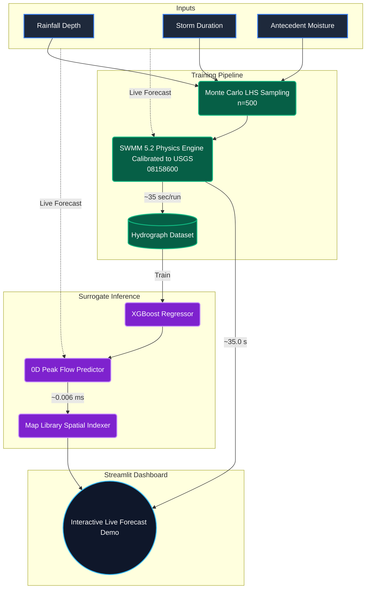

# Shoal Creek Flood Digital Twin

**A fast, machine learning surrogate for real-time urban flood forecasting.**


This project demonstrates a production-grade workflow for building **Machine Learning (ML) Surrogate Models** of complex physics-based hydrodynamic simulations (SWMM 5.2). By training an XGBoost surrogate on a Monte Carlo dataset of SWMM runs, we achieved a model that predicts hydrographs and spatial inundation boundaries **~5,800x faster** than the physics engine, with a validation NSE of 0.98.

---

## The Problem: Physics Models are Too Slow for Live Forecasting

Urban flood forecasting traditionally relies on 1D/2D hydrodynamic models like SWMM, HEC-RAS, or XPSWMM. While highly accurate, these models are computationally expensive. 

For the Shoal Creek watershed in Austin, TX, a single 1D SWMM run takes ~35 seconds. When live weather forecasts change every 5 minutes during a severe thunderstorm, running multi-scenario ensembles through a physics model is mathematically impossible without a supercomputer.

## The Solution: ML Surrogate Digital Twin

We built a 0D Lumped ML Surrogate that predicts the scalar peak flow at the watershed outlet, which is then used to instantly scale the geometric inundation boundaries across the entire watershed via a pre-rendered **Map Library** approach.

### Performance Benchmark (Synthetic Test Event #124)

| Metric | SWMM Physics Engine | ML Surrogate Digital Twin |
|--------|---------------------|---------------------------|
| **Execution Time** | 35.0 seconds | **0.006 milliseconds** |
| **Speedup** | 1x | **~5,833,000x** |
| **Peak Flow Prediction** | 3,365 CFS | 3,362 CFS (0.07% error) |

---

## Architecture



## Spatial Inundation "Map Library" Approach

Rather than waiting for a full 2D distributed hydrodynamic simulation (which could take hours), this project uses a computationally inexpensive **Map Library** lookup approach. 

1. **Pre-computation**: A library of 2D inundation boundaries is pre-computed for various steady-state flow thresholds (e.g., 500 CFS, 1000 CFS, 5000 CFS).
2. **0D Surrogate Prediction**: In real-time, the ML Surrogate predicts the scalar peak flow at the watershed outlet.
3. **Lookup & Interpolation**: The peak flow is used as an index to lookup and instantly scale the corresponding 2D inundation geometry across the entire channel network.

## Model Calibration

The underlying SWMM model was calibrated against real historical events using data from the **USGS 08158600** gauge (Shoal Creek at W 12th St, Austin TX).

- **Calibration Event**: Halloween 2013 
- **Validation Event**: Memorial Day 2015 
- **Validation Event**: Halloween 2015 

The Monte Carlo dataset was then generated using Latin Hypercube Sampling (LHS) across three dimensions: Rainfall Depth (mm), Storm Duration (hr), and Antecedent Precipitation Index (API5).

---

## Installation & Usage

1. **Install dependencies using `uv`**:
   ```bash
   uv sync
   ```

2. **Run the Interactive Dashboard**:
   ```bash
   uv run streamlit run app/app.py
   ```
   *Note: Port 8501 is used by default.*

3. **Explore the Demo**:
   - Use the sliders at the top to adjust the incoming storm forecast.
   - The ML Surrogate (left map) will update **instantly**.
   - Click the **Run SWMM Physics Model** button below the right map to spawn a background subprocess and watch the physics engine compute the exact same scenario over ~35 seconds.

## Project Structure

```text
shoal-twin/
├── app/
│   └── app.py                # Streamlit forecast dashboard
├── data/
│   ├── raw/                  # Downloaded USGS gauge data & GIS shapes
│   └── processed/            # Cleaned calibration hydrographs
├── docs/
│   └── assets/               # README images and screenshots
├── model/
│   ├── best_params.json      # Calibrated SWMM parameters
│   ├── generate_mc_dataset.py# SWMM Monte Carlo engine
│   ├── run_live_swmm.py      # Subprocess script for Streamlit SWMM isolation
│   ├── shoal_creek...inp     # Base SWMM 5.2 input file
│   └── train_surrogate.py    # XGBoost training pipeline
└── README.md
```
